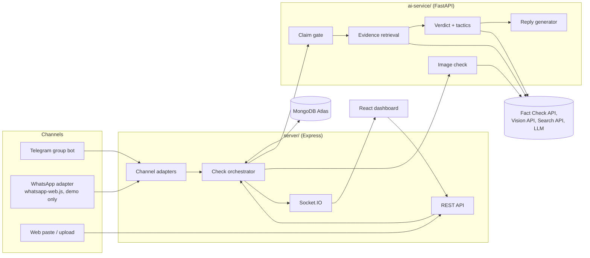
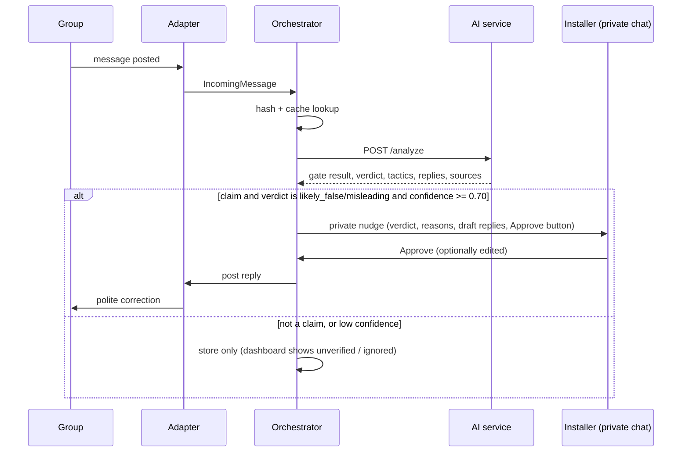

# Architecture: SachCheck

## 1. Components



## 2. Responsibilities

| Component | Responsibility |
|---|---|
| Channel adapters | Normalise incoming messages into one `IncomingMessage` shape; post approved replies back; send private nudges to the Installer |
| REST API | Dashboard data, manual paste/upload checks, approve/dismiss actions, data deletion |
| Check orchestrator | Dedupe by message hash, call the AI service, persist results, decide whether to nudge, emit socket events |
| AI service | Stateless analysis: gate, evidence, verdict, tactics, replies, image check |
| MongoDB | Persist groups, checks, evidence, nudges, cache |
| React dashboard | Show checks, verdict badges, tactics, sources, copy/approve buttons |

## 3. Normalised message shape

```json
{
  "platform": "telegram | whatsapp | web",
  "groupId": "string",
  "messageId": "string",
  "senderRef": "hashed id, never the display name",
  "text": "string | null",
  "imageUrl": "string | null",
  "receivedAt": "ISO timestamp"
}
```

## 4. Main sequence



## 5. Check status lifecycle

`received -> gated -> analyzing -> completed -> nudged -> approved | dismissed`

Shortcuts: `received -> ignored` (not a claim), `analyzing -> failed` (retryable).

## 6. Design decisions

- **Human in the loop.** Only the approve action posts to the group. The adapter exposes `sendToGroup` solely to the approve handler.
- **Decoupled AI service.** Node never calls LLM or search APIs directly; the AI service owns providers and keys.
- **Provider abstraction.** One `LLMClient` interface with `generate_json(prompt, schema)`; swap Gemini/Claude via `LLM_PROVIDER`.
- **Idempotency.** `(platform, groupId, messageId)` is unique; reprocessing the same message returns the stored check.
- **Caching.** Key on a hash of normalised text (lowercase, stripped URLs/whitespace) to reuse results for forwarded duplicates.
- **Timeouts and fallbacks.** 15 s timeout on AI calls; on failure mark `failed`, show retry in the dashboard, never nudge.
- **Rate limiting.** Per-group limit (e.g. max N analyses per minute) to protect free-tier quotas.
- **Privacy.** Store hashed sender refs, message text and verdicts only; images are processed then discarded unless the user opts in.

## 7. Failure modes to test

- AI service down: dashboard shows `failed`, bot stays silent.
- LLM returns invalid JSON: retry once with a repair prompt, then mark `failed`.
- LLM cites a URL that was not retrieved: strip the citation; if no valid source remains, downgrade verdict to `unverified`.
- Duplicate forwards in a burst: one analysis, one nudge.
